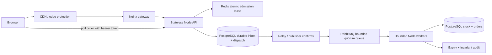

# Architecture and correctness argument

## Scope, assumptions and evidence

**Assumptions:** one sale/SKU, one region, exactly 500 physical phones, whole-unit quantities 1–500, no partial order allocation, no restock/refunds after confirmation in this version. All inventory writers use this service. PostgreSQL commits and its underlying durable storage survive process/container failure; there is no split-brain primary or silent loss of acknowledged WAL. PostgreSQL `synchronous_commit` remains enabled. Production needs synchronous failover with fencing to preserve this assumption. The user deliberately chooses a demo payment outcome; there is no external charge or real fulfillment integration. UTC server clocks are synchronized; PostgreSQL time controls reservation expiry. Browser time is informational. The default event is 8:00 PM Asia/Kolkata, October 28, 2026.

**Verified locally:** actual PostgreSQL 16, Redis 7, RabbitMQ 4 services; five essential integration tests. Tests allocated 500 units under competing multi-unit orders; exercised duplicates, release/reuse, simulated payment, and the full HTTP/queue/worker/status flow. See README for repeatable commands. These are functional tests, not availability or throughput certification. No 100k-concurrency, device performance, regional failover, CDN, bot-classification, or real payment benchmark has been run.

The complete implementation corresponds to the following flow:



CDN/edge protection in the diagram is a production deployment boundary; the local stack implements Nginx onwards. The browser never calls the database. The API performs a small synchronous durable **inbox** insert but no inventory/order-processing transaction. This is an explicit exception to a purely broker-first API: atomic idempotency, immutable payload binding, finite inbox capacity, and durable enqueue share one PostgreSQL commit. Calling Redis first and RabbitMQ second without a durable recovery record leaves a crash gap. Calling RabbitMQ first and storing idempotency later accepts conflicting payloads or loses status tracking. A broker-only alternative needs an additional durable deduplication/state protocol. The inbox avoids claiming a distributed transaction Redis and RabbitMQ do not supply. Production must cap how much traffic reaches that insert.

## Phase A — Frontend and client experience

### Design and implementation

`public/index.html`, `app.js`, and `style.css` implement product details, quantity selection, sale opening, loading/submitting, queued, reserved/payment pending, confirmed, rejected/failed/expired, retrying, and current sold-out states. A quantity is never silently reduced. Cached availability is a hint; the database can reject if remaining quantity changed. Reserved units can expire, so currently sold out is not necessarily permanent.

A synchronous `busy` guard and disabled submit state prevent repeated clicks, including rapid events before the next render. This is leading-edge submission throttling rather than adding an artificial debounce delay to checkout. A separate click debounce would only improve ergonomics; **server idempotency is mandatory**. The browser stores one random key plus canonical request body before submission, retains it across ambiguous failures/reload, retries with bounded exponential backoff and jitter, and polls accepted status with its bearer token. Backend rate limits are independent of browser controls. Multiple tabs can still create distinct orders, as users are allowed multiple units/orders; identity-level abuse prevention is a separate concern.

No optimistic inventory decrement or purchase success is displayed. Optimistically show only submitting/queued. A rejection rolls back to a terminal explanation and an explicit new-checkout action; decline/expiry return stock on the server. Network timeout does not mean checkout failed; the client retries the same key or resumes order status. Form labels, native keyboard controls, visible focus, polite atomic live-region updates, and disabled state are included. Avoid announcing every polling tick; messages change only when meaningful text changes. Manual screen-reader/browser accessibility testing remains necessary.

### Delivery and targets

**Targets, not measured results:** initial checkout JS <200 KB **minified and gzip-compressed**, counting every eagerly downloaded entry/shared JavaScript chunk required for the product page and checkout interaction; exclude lazily loaded post-checkout/admin chunks but report them separately. This project has one small unbundled JS module and no framework/vendor chunks. Record the served module's raw/gzip bytes separately; source gzip size is not a minified-bundle benchmark. A bundler would add complexity without current benefit.

Interactive target <1.5 seconds on an **assumed representative mid-range Android device, Chrome, 4× desktop CPU slowdown when emulating, 10 Mbps down/1 Mbps up, 80 ms RTT, cold HTTP/browser cache, warm CDN**. Use repeat runs and report p75/p95; also test cold CDN and weaker mobile networks separately. Classic Lighthouse TTI is version-dependent/removed from recent reports: measure a custom `checkout-interactive` mark after sale data and event handlers are ready, plus LCP/INP and long tasks. Do not equate a small file with meeting the target. Sale data outages may deliberately keep checkout unavailable.

Production CDN serves versioned immutable assets near users and absorbs product-page bursts. Current filenames revalidate (no immutable caching that might deploy stale JS); content-hash assets before enabling immutable headers. Nginx coalesces/caches product reads for one second; stale product data during an upstream failure cannot grant stock. Do not cache checkout or private order responses. Prefetch only likely next-step assets during idle time to lower subsequent navigation latency; none are currently needed. Lazy-load future analytics, reviews, recommendations, and admin screens to avoid blocking checkout. CSS phone illustration eliminates a hero-image fetch.

### Status transport alternatives

| Option | Benefit | Cost / decision |
|---|---|---|
| Jittered polling | Stateless, reconnects naturally, simple infrastructure | More requests, seconds of latency; **chosen** for small bounded accepted population and short sale |
| SSE | One-way push, automatic reconnect, less repeated work | Long-lived connections, proxy timeouts, replay/event-store requirements; switch when measured poll traffic/latency warrants it |
| WebSockets | Bidirectional realtime | Connection state, heartbeat, scaling and reconnect complexity; checkout needs no duplex stream |

Order polling starts ~1 second and backs off to 4 seconds plus jitter, stopping at terminal state. Product polling is five seconds and edge-cached. At 100k visitors that can still be ~20k edge requests/s, so CDN request capacity matters. Do not send every waiting visitor to an uncached order query. A production waiting-room ticket (below) is distinct from an accepted order.

## Phase B — Gateway, durable pipeline and workers

### Capacity and overload plan

100,000 arrivals/10 seconds implies **10,000 requests/second average**, not a peak bound. 100,000 genuinely simultaneous open connections also requires enough connection state, descriptors, memory, ports and TLS capacity; average RPS alone is insufficient. An instantaneous burst can exceed this by orders of magnitude.

**Sizing example, assumptions only:** provision edge capacity for 100k+ connections and 2× the 10k/s average burst rate. If a load-tested gateway sustains `g` RPS at the required p99 and `c` connections with headroom, use at least `max(ceil(20000/g), ceil(100000/c))` replicas plus failure headroom. If a measured API replica safely sustains `a` admission checks/s, API replicas must cover admitted throughput / `a`, with resource and connection budgets. These symbols require measurement on chosen hardware; no provided instance is claimed to deliver them.

Do **not** forward all 100k clients to PostgreSQL. Production edge waiting-room admission issues signed, short-lived tickets in bounded randomized batches; hold users outside durable checkout until admitted. Tickets express eligibility, not inventory or acceptance. Verify tickets server-side and bind to authenticated identity/session; the reference stack does not implement a trusted waiting-room vendor or identity provider. Until provisioned, Nginx/IP and Redis limits plus bounded inbox shed traffic with 429/503. Over-target traffic gets explicit retry/backoff, queue-position UI only if a real waiting room supplies it, or a static degraded sale page. Capacity excess never becomes a false purchase success.

The local stack is a functional reference: Nginx per-worker connection configuration, `least_conn`, keepalive, fixed proxy/body/header deadlines, body size limits, per-IP connection/rate limits, API maximum connections, bounded PG pools and inbox/broker limits. Least connections avoids sending equal work to a slow saturated replica; round robin is simpler for uniform requests and usually close. Nginx passive failures route away after two failures in five seconds; Docker DNS periodically discovers scaled API containers. It does not perform active HTTP readiness routing. Production load balancer must use `/health/ready` and startup probes; `/health/live` only signals the process. Compose dependency health checks cover initial startup. DB/Redis readiness loss must remove an API replica until recovery; broker outage intentionally permits bounded inbox acceptance.

Pre-warm the edge, API, DB connections, broker and workers before the known event. Autoscale on arrival rate, in-flight admissions, pool wait, inbox age, queue age, CPU/event-loop lag and rejection rates; replica creation/pull/warmup takes time, so reactive scaling cannot absorb a ten-second burst alone. Workers scale only until inventory transaction and DB budgets saturate. Limit total `replicas × DB_POOL_MAX` below max connections minus migration/operations/failover headroom. Measure lock wait and cap queues; queueing delays cannot grow indefinitely.

### Fair access and abuse

Implemented: Nginx per-IP limits, Redis cross-replica 10-second limits, strict payload validation, random idempotency keys, finite provisional quantity leases, max 2 KB bodies, bounded connections/timeouts, no logged credentials. An IP limit does not equal one user and can harm shared-NAT users; it does not stop distributed bots. Production needs authenticated identities, ticket replay prevention, WAF/bot scoring, risk-based challenges with accessible fallback, payment/fraud checks, and audit trails. Detection is probabilistic and has false positives/negatives. Avoid asserting FIFO fairness: DB lock scheduling and worker completion reorder requests. Randomized edge admission is fairer than lowest-network-latency wins; FIFO requires sequenced durable tickets. No per-user one-unit limit is assumed. Large valid quantities are supported, but can exhaust all 500 phones; that is the requested policy.

### Acceptance, durability and queue choice

A request is **accepted only when an order UUID, canonical payload hash, status token, queued order/inbox row and dispatch record commit atomically in PostgreSQL**. This is durably enqueued in a database-backed queue; RabbitMQ publication may follow later. HTTP 202 is never emitted before commit. If the response is lost after commit, retry finds the same row. The UI and contract distinguish 202 queued, reserved pending, confirmed complete, rejected insufficient stock, failed payment/processing, and expired. Rate limits/overload are unaccepted unless a prior ambiguous request committed; lookup by the same key resolves this.

**Zero loss of accepted requests is conditional:** durable WAL/storage, correct backup/failover/fencing, no administrator deleting records/volumes, and eventual service recovery. Total loss of PostgreSQL's acknowledged data is outside the guarantee. An accepted request gets a durable eventual outcome, **not a guaranteed stock allocation or successful payment**. Redis availability is required for new admission; PostgreSQL unavailability fails closed. Broker unavailability permits acceptance until the bounded inbox fills. Full inbox returns 503 without creating a new order. A full RabbitMQ queue rejects publish, leaving dispatch durable and due; there is no silent drop of accepted work. Single-node Compose volumes survive container restart, not host/disk destruction.

| Broker | Fit and trade-off |
|---|---|
| RabbitMQ **chosen** | Work queue, bounded prefetch, publisher confirms, redelivery and quorum queues fit short checkout jobs; smaller operational surface for this demo |
| Kafka | Strong replay/log retention and partitioned throughput, useful for broader event streaming; consumer offsets, per-order state/idempotency, retry topics and per-partition ordering add complexity here; Kafka transactions do not atomically include PostgreSQL/payment |
| PostgreSQL-only queue | Could use SKIP LOCKED workers directly with fewer services; viable at modest admitted load. RabbitMQ supplies dispatch isolation/prefetch/queue visibility, while the durable inbox closes the acceptance gap |

All delivery is treated as **at least once**. Publisher confirms plus persistent messages and durable quorum queues do not grant exactly-once DB side effects. Production RabbitMQ requires three (or another supported quorum size) nodes across failure domains, tested quorum availability and disk alarm behavior. Local one-node quorum queue provides restart durability only. Poison messages go to `checkout.dead`; business retry exhaustion also records `dead_letters` in PostgreSQL. DLQ retention/alerting and redrive tooling are production tasks; do not blindly replay declined/expired business outcomes.

### Responsibilities and runtime

- API: validate, rate-limit, acquire Redis provisional tokens, atomically deduplicate/enqueue, return status credentials. No inventory row lock, payment wait or external HTTP on this path.
- Relay: bounded batches of 20 dispatch records using SKIP LOCKED, publish with confirmation before advancing a retry timer. Records remain until orders are terminal, so lost messages can be re-created even after a broker restart. Crash between publication and database commit creates duplicates, not loss.
- Worker: prefetch/concurrency 8 by default, lock one order, execute one short inventory/payment transition and commit before ACK. Default pool 12 bounds database concurrency. Errors persist jittered exponential retry timing; next dispatch is delayed. If DB is unavailable even retry bookkeeping fails, the original dispatch remains and will redeliver. After eight recorded processing failures, release any reservation and persist a failed outcome/dead letter transactionally.
- Expiry sweep: every 500 ms, bounded 50-row SKIP LOCKED batch; independent of RabbitMQ, serialized with payment by the same order lock. It runs in each worker; DB outages defer release safely.
- Reconciler: every five seconds, audit DB order aggregates vs authoritative stock in a single SQL snapshot. Mismatch stops that worker and requires investigation. No counter rewriting or silent “repair”.

Node.js 22 is chosen for one language, mature async clients and a tiny dependency footprint. Go would offer low-overhead concurrency and explicit contexts but adds another toolchain without a measured bottleneck. No synchronous filesystem, CPU-heavy hashing loops, sleeps, or external payment calls inside the event loop's request handler. Hashing covers a tiny bounded payload; JSON is capped. Await I/O, bound batch size/prefetch/connection counts; offload future CPU work to worker threads/services. A Go implementation would likewise need semaphores, deadlines, bounded channels and cancellation, not one unbounded goroutine per request. Graceful API shutdown drains requests; workers cancel consumption and drain in-flight work before closing. Container force-kill is safe through transaction rollback/redelivery.

Indexes: unique UUID/key for constant-time lookups; partial due/expiry indexes; dispatch due index. Product query fetches a single aggregate row. Order status reads one row, with no joined customer/product N+1. Avoid ORMs loading product/payment/customer per job: batch immutable catalog reads and store necessary sale snapshot values in production. Current capacity count is bounded to 2,000 pending orders but becomes costly with large retained history; production use an admission quota ledger/partitioned inbox only after measuring. No unbounded list endpoint exists. Public product reads are cached at Nginx; orders are private/no-store.

## Phase C — Inventory consistency and persistence

### Why the previous system could oversell

Likely causes (hypotheses without the previous source): `SELECT stock` then application check then `UPDATE`, retrying a timed-out checkout as a new purchase, non-atomic counter rollback, cache/DB divergence, and external payment success detached from reservation ownership. For example, two requests both SELECT 1 under read committed; both pass; if both write `stock=0` and confirm their own order, two confirmations exist against one decrement. If both decrement unconditionally, stock can go negative. Transactions alone do not fix this split check/write at read committed without a conditional update or locking.

Synchronous HTTP paths that hold stock row locks through product queries, N+1 queries or payment calls serialize the burst. Pools exhaust; requests time out while old transactions continue; retries amplify load. Optimistic version checks (`WHERE version=old_version`) can preserve correctness but on one hot SKU yield conflicting retries, thundering herds and poor tail latency. Pessimistic `SELECT ... FOR UPDATE` prevents concurrent changes but waits and locks across application round trips if misused. Use pessimistic locks for individual order transitions and brief bounded critical sections. Use a single conditional stock update for the scarce SKU:

```sql
UPDATE inventory
SET available = available - $1, reserved = reserved + $1
WHERE id = 1 AND available >= $1
RETURNING id;
```

PostgreSQL rechecks the predicate under concurrent updates. It still takes a brief row lock; this design **does not claim lock-free inventory**. Only bounded workers touch it, never the entire HTTP burst, and no network/payment I/O happens while locked. 500 total units justify this simple correctness boundary. If measured serialized worker throughput is insufficient, preallocated DB unit tokens partition contention but add complexity for multi-unit all-or-nothing purchases; shard only with a verified invariant.

### Authoritative invariant and transaction boundaries

PostgreSQL is the single source of inventory truth:

`available >= 0`, `reserved >= 0`, `confirmed >= 0`, and `available + reserved + confirmed = total = 500`.

A schema CHECK enforces the arithmetic; order quantity must be 1–500. Initially (500,0,0). Allocation moves `(available -= q, reserved += q)` only if sufficient. Confirmation moves `(reserved -= q, confirmed += q)`. Expiry/decline/exhausted processing returns `(available += q, reserved -= q)`. Confirmed stock never returns to availability in this version. Thus concurrent valid transitions cannot allocate **simultaneously held plus permanently confirmed units** above 500. Released units may be allocated again; cumulative historical reservation quantities can exceed 500, which is necessary for resale after failure. That is not overselling.

Boundaries in `src/orders.js`:

1. Enqueue transaction: short capacity lock, immutable idempotency/payload lookup, queued order + dispatch insert. It never locks inventory. A unique key handles concurrent duplicate attempts; same key with changed payload is 409. Canonical quantity/outcome define the payload; add SKU/price/account to the binding when those become dynamic.
2. Reserve transaction: lock order by ID; if queued, conditional update stock and change order to reserved/payment pending with database TTL, or persist rejected. Both commit together.
3. Payment-result transaction: lock order; check database expiry and eligibility; success moves reserved to confirmed and sets payment paid/fulfillment ready; decline releases and fails. Duplicate delivery sees terminal/current state and has no extra effect.
4. Expire transaction: lock due reserved order; release stock and mark expired/cancelled atomically. Competing payment and expiry are serialized; once expired, late payment cannot confirm it.

The simulator produces a payment result deterministically from the durable order payload. No external funds can be charged twice. **A real payment service requires an additional provider-idempotency key (order UUID), durable attempt records/outbox, signed webhook inbox deduplication, and cancel/refund reconciliation.** Do not put external payment calls inside the stock transaction. An unknown provider result must retain a fenced payment state or explicitly cancel/refund before releasing; simply expiring a charged order would strand money. This is a production integration requirement, not a claim that the demo charges funds.

State distinction: `queued → reserved → confirmed`, or queued → rejected, reserved → failed/expired. Payment is `not_started → pending → paid/declined/cancelled`. Fulfillment is `not_started → ready`; `shipped` is a schema state reserved for a future authenticated fulfillment integration, not an implemented shipping service. Only confirmed+paid can be fulfilled.

### Redis atomic tokens: guarantees, limits and compensation

`src/admission.js` executes one Lua script, on one Redis hash slot (`{sale}`). It removes expired leases, sums active quantities, and grants **q units atomically only if provisional tokens in use + q ≤ 500**. Lease ID derives from the request key, duplicates reuse the quantity, and mismatched quantity is rejected. Max 500 one-unit active leases bounds Lua work. Use Redis server/monotonic time in a multi-host production deployment to avoid clock-skew admission distortions; the reference uses synchronized-host assumptions. Redis atomicity is single-primary execution, not cross-store durability; AOF and replica failover can lose recent writes. No-eviction prevents silent deletion under memory pressure; OOM/errors fail admission closed.

**These are short-lived provisional inventory-admission tokens, not confirmed stock or promises of DB availability.** The token budget represents concurrent acceptance work and resets as it is handed to the durable DB inbox; no mirrored persistent Redis stock counter is trusted. An admission can ultimately be rejected for insufficient DB stock. The UI never calls a Redis lease a reservation or a purchase. Final inventory reservation is only the DB `reserved` transition. This deliberately avoids distributed stock ownership or unsafe absolute Redis counter “reconciliation”.

If Redis succeeds and DB fails, release the lease in `finally`; crash before release is recovered by TTL. If the DB commits but response/Redis release fails, the accepted request survives; duplicate lookup bypasses Redis gates. If Redis loses leases, provisional over-admission can occur but DB stock remains correct. Redis restart cannot restore or consume inventory. DB unavailable means stop admissions rather than trusting cached stock. Periodic DB audit and expiry sweep reconcile durable order/stock state; Redis's next admission prunes orphan provisional leases by TTL. **There is no dual-write stock counter requiring guessed repairs.** Longer-lived Redis-authoritative stock holds would need fencing, a durable reservation ledger and failover proof; they are unnecessary here.

When sufficient valid payments complete while retrying demand remains, all 500 can sell. Expired/declined units return to the available pool and later requests may buy them. The app does not promise to resurrect terminal rejected orders or sell without new eligible demand. Multi-unit all-or-nothing requests can leave a remainder when every remaining buyer requests a larger quantity; availability must be offered to a sufficiently small valid request. No arbitrary one-unit-per-person restriction is introduced.

### Cost, reliability and performance

An inbox transaction and two small background processes cost more than trusting Redis counters, but make recovery and idempotency reviewable. RabbitMQ plus PostgreSQL is more infrastructure than a DB-only queue; it is useful for the required asynchronous middleware isolation and offers a natural place for work concurrency. Redis is cheap admission/rate state, not a second authoritative ledger. Production synchronous database replicas and three-node broker cost more and may reduce availability during a partition; correctness requires failing closed rather than selling on two primaries. Fast user acknowledgement is bounded by durable DB commit, not a fabricated sub-millisecond promise. The serialized inbox capacity check is a deliberate reference bottleneck; a production edge waiting room and capacity test are required before calling this high-scale ready.

## End-to-end lifecycle

1. Browser downloads CDN/static page, reads edge-cached product availability and server opening time. User selects quantity 3 and a simulated payment outcome.
2. Browser persists a random idempotency key/body, disables duplicate submission, and POSTs through the gateway.
3. Gateway enforces size/rate/connection limits and balances an API replica. API validates and first checks for a prior durable result. New attempts check opening time and Redis per-IP limit, then atomically obtain 3 provisional tokens.
4. API commits queued order UUID + payload binding + status bearer token + dispatch in the database inbox transaction, subject to finite capacity. It releases the provisional lease and returns 202 with status credentials. Crash before response is handled by the same-key retry.
5. Relay selects due dispatch, publishes persistent order ID to RabbitMQ, waits for publisher confirmation, advances dispatch time. A crash creates safe duplicate deliveries. Client polls authenticated order status.
6. Worker locks the order; conditional DB update reserves 3 units or rejects if fewer remain; commits, then ACKs. State reserved/payment pending is visible. No stock or payment success is inferred from queue acceptance.
7. Due dispatch causes another message after the configured payment delay. Worker locks/checks expiry and commits simulated paid + confirmed + fulfillment ready, or declines/releases. If payment never completes, the independent expiry sweep releases stock.
8. Worker ACKs after commit; relay removes terminal dispatch. Browser displays the durable terminal outcome and stops order polling. Audit compares order aggregates to inventory; later requests can buy released stock.

## Failure analysis

| Failure / boundary | Durable state and mitigation | User result |
|---|---|---|
| Duplicate click / delivery / client retry | Unique key+payload, order row lock, state-checked stock transitions; ACK after commit | Same ID/outcome; conflicting body gets 409 |
| API dies after Redis lease, before DB commit | No accepted request; TTL removes provisional lease | Timeout, retry same key |
| API dies after DB commit, before response | Order/inbox/dispatch and token persisted atomically | Ambiguous timeout; retry resolves original acceptance |
| Redis outage / Lua OOM / failover loses writes | New admissions fail closed on errors; duplicates read DB; extra provisional grants cannot bypass stock condition | 503/retry; accepted orders continue |
| Broker down / queue full / unconfirmed publish | Durable inbox/dispatch retained; relay retries with jitter; finite inbox eventually returns 503 | Accepted stays pending; new excess traffic unaccepted |
| Relay crash before/after publisher confirm | Timer update and retained dispatch recover; possible duplicate publish | No lost accepted work |
| Worker crash before/after DB commit / before ACK | Uncommitted transaction rolls back; RabbitMQ redelivers and dispatch remains | Retry idempotently, no duplicate stock movement |
| Worker DB exception | Message attempt dead-lettered, DB retry timer/backoff and retained dispatch; retry-limit transition compensates reserved stock | Pending then failed only after durable terminal decision |
| PostgreSQL down | No new 202; broker attempts may fail but inbox persists; expiry/audit retry after recovery | 503/new attempts; accepted statuses temporarily unavailable |
| Payment decline / payment timeout | Transactional release; database TTL and sweep; confirmation/expiry share order lock | Failed/expired; new checkout required |
| Expiry sweep competes with confirmation | One order lock; first valid transaction establishes state, later transition checks it | Exactly one final state |
| DB invariant audit mismatch | Worker stops, alert/manual investigation; never reset stock from Redis | Degrade/stop sale; investigate all writers |
| Gateway/client timeout or 502/503 after upstream work | Commit may have happened; client reuses exact key | Never generate a fresh key merely for retry |
| Disk destruction, asynchronous DB failover losing acknowledged WAL, split brain | Outside local durability guarantee; synchronous replicated storage, fencing, restore drills required | Cannot claim zero accepted-request loss without those prerequisites |
| Real payment charged but response unknown | Outside simulator; provider idempotency + query/webhook reconciliation, fenced release/refund workflow required | Do not declare success/failure until resolved |

## Requirement-validation checklist

“Implemented/tested” refers to this local reference, not a production scale certification.

| Mandatory requirement | Location / evidence / remaining boundary |
|---|---|
| Product, arbitrary valid quantity, loading/queued/sold-out/failed/confirmed | Phase A, `public/`; multi-unit and final-unit tests |
| Duplicate submissions, debounce/throttle, idempotency, retries/timeouts | Phase A busy guard, disabled button, persisted key, jitter; API duplicate/conflict test |
| UI rollback and accessibility/screen-reader status | Phase A, native labels/live region/focus, explicit terminal reset; manual assistive-device testing pending |
| JS <200 KB and interactive <1.5 s definitions/conditions | Phase A delivery targets; device/CDN performance not benchmarked |
| CDN, prefetch, lazy-load; polling/SSE/WebSocket comparison | Phase A; CDN/future lazy chunks are deployment recommendations, local polling implemented |
| 100k/10s capacity estimate, beyond-target traffic | Phase B formulas, waiting-room boundary, load script; full capacity unverified |
| Gateway balancing, rate limits, bots/fairness and limits | Phase B, Nginx/Redis implemented; authenticated bot/ticket system explicitly production work |
| Connections, deadlines, backpressure, autoscaling/prewarming | Phase B/Nginx/server/pool/prefetch; production scaler/LB not provisioned |
| Precise acceptance, conditional zero loss, excess load semantics | Phase B durable DB inbox contract; tested acceptance before workers start |
| Stateless tier, async database processing, producer/relay/consumer/status duties | Phase B and source files; essential HTTP-to-worker test |
| At-least-once, duplicates, exponential jitter, DLQ, bounded worker/queue | Phase B, `broker.js`, `relay.js`, `worker.js`, `failAttempt`; normal flow tested, chaos unrun |
| Node event-loop safety, pools, query/index/N+1 controls | Phase B, config/schema/query design |
| Accepted/pending/completed/rejected/failed API and UI distinction | README contract, `view`, frontend messages; 202 and terminal replay tested |
| Crash/broker/worker/DB recovery | Failure table, inbox/dispatch, row transactions, retry loops; exhaustive fault injection unrun |
| ≤500 units, ACID boundaries, no negative stock, single authority | Phase C constraints/conditional movements; competing allocation test and SQL audit |
| Sell all with valid demand; release/reuse multi-unit stock | Phase C, expiry/payment tests including 237+263 and 500-unit replacement |
| Pessimistic vs optimistic, SELECT/UPDATE race, retry storm | Phase C concurrency analysis |
| Redis Lua atomicity, single-node/failover limits and suitability | Phase C admission implementation and explicit provisional semantics; concurrent lease test |
| Cross-store failure/TTL/reconciliation/compensation | Phase C and failure table; TTL plus DB release/audit, no mirrored stock counter |
| Idempotent creation/processing, expiry, retries, rollback | `orders.js`, unique keys, row locks, transactional state machine; essential tests |
| Payment failure/crash/timeout safety; stock/payment/fulfillment distinction | Phase C state transitions, simulation tests; actual provider/shipping integration out of scope |
| Runnable source, schema, middleware, infrastructure/config/logging | README file map, Compose/Docker/Nginx, actual image build and real-service tests |
| Essential tests and configurable 100k load scenario | `tests/checkout.test.js`, `scripts/load.js`; benchmark not claimed |
| Lifecycle, failure analysis, assumptions/risks/readiness | These final sections and README |

## Production-readiness items and unresolved risks

This reference preserves the inventory invariant under concurrent application operations and ordinary recoverable component failures under the stated durability assumptions. It is not a finished public commerce service or a verified 100k deployment. Before a festival launch:

- Measure edge connections/RPS, real arrival distribution, API durable enqueue p99, serialized inbox lock wait, DB WAL latency, Redis Lua latency, broker confirms, worker lock wait, event-loop lag, and time-to-terminal. Pre-warm and load test the entire deployment with at least the target and beyond-target shed behavior; set SLOs and alerts from measured budgets. The reference global capacity lock is a likely bottleneck.
- Provision CDN/TLS, managed WAF/identity-aware waiting room, account authentication, signed eligibility tickets, per-identity fairness, distributed rate limits at the edge, accessible challenges and fraud controls. Status bearer token is a demo capability, not account authentication; treat idempotency keys as sensitive and bind them to a principal in production.
- Deploy synchronous PostgreSQL HA with no split-brain writes, quorum RabbitMQ across failure domains, backup/PITR/restore drills and durable encrypted disks. Test accepted-request recovery across the exact failure modes you promise. Redis persistence/failover affects admission availability only.
- Integrate real payment with durable idempotent intents, webhook verification/deduplication, refunds/reconciliation, currency minor-unit arithmetic, tax/shipping and customer/order snapshot data. Keep these immutable payload fields in the key binding. Fulfillment authorization/audit still needs implementation.
- Replace demo passwords, lock network paths to private services, use workload-specific database roles/permissions and credential rotation, TLS/service auth, CORS/CSRF policy for eventual cookie auth, retention/privacy controls, supply-chain reviews and pinned image digests.
- Bound/retain/monitor DLQs and historical orders, add operational redrive only for eligible transient failures, and alert on invariant violation. The reference audit fails one worker closed but is not a global incident-control switch; deploy a global sale kill switch and runbook.
- Manually test browser reload, offline/resume, keyboard/screen reader, shared NAT rate-limit behavior, low-end devices and page performance. Current product polling can synchronize browsers; CDN cache request coalescing is necessary and jitter should be extended to catalog polling before large-scale use.
- Use inventory token partitioning or a sharded durable acceptance quota only if measurements demand it, and re-prove multi-unit atomicity and failover fencing. Avoid spreading the authority across Redis, DB, broker and payment without an explicit state machine.
